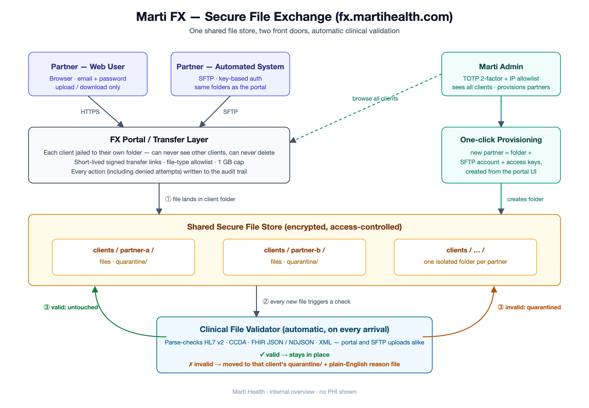

# Marti FX — Architecture Overview

Secure file-exchange portal at **fx.martihealth.com**, layered over the existing
AWS Transfer (SFTP) landing bucket. One shared file store, two front doors
(web + SFTP), automatic clinical validation on arrival.



Diagram source: [`architecture-diagram.html`](./architecture-diagram.html) —
re-render with Playwright/Chromium at 1240×860, deviceScaleFactor 2.

## Components

- **Web portal** (`artifacts/file-exchange` React/Vite + `artifacts/api-server`
  Express 5 on ECS Fargate, behind the shared ALB): client users are jailed to
  `clients/<slug>/` (browse/upload/download, **no delete**); admins see all of
  `clients/*` and provision partners (S3 prefix + Transfer user with scope-down
  jail + SSH keys) from the UI.
- **SFTP** (AWS Transfer): unchanged; reads/writes the identical tree, so the
  portal and SFTP always show the same files.
- **Auth**: clients = email/password; admins = password + **TOTP 2FA** +
  **IP allowlist** (`ADMIN_IP_ALLOWLIST` env on the task definition).
- **Authz chokepoint**: `lib/authz.ts` (`resolvePrefix` / `assertKeyAllowed`,
  traversal-proof). Every action — including denied attempts — is written to
  the `audit_log` table, fail-closed before any presigned URL is issued.
- **Transfers**: presigned PUT (15 min) / GET (5 min); upload extension
  allowlist in `artifacts/api-server/src/routes/files.ts` (server-side only,
  no frontend mirror); 1 GB cap.

## Clinical validation & quarantine (added 2026-10-22)

HL7/FHIR interchange formats are accepted: `hl7`, `ccda`, `cda`, `ndjson`
(plus `json`/`xml`, which were always allowed).

Every object created under `clients/*` — web or SFTP — triggers
**`marti-fx-clinical-validator`** (Lambda, `artifacts/clinical-validator/`)
via an EventBridge rule of the same name. The existing S3→SQS forwarder and
SNS upload email are untouched and still fire.

Parse checks (see `validators.mjs`; 22 unit cases in `test/run.mjs`, run with
`pnpm test`):

| Extension | Check |
| --- | --- |
| `hl7` | MSH header, field-separator sanity, segment grammar (HL7 v2) |
| `ccda` / `cda` | well-formed XML with a `ClinicalDocument` root |
| `xml` | well-formed XML (generic data files stay allowed) |
| `json` | must parse; FHIR shape rules apply only if `resourceType` is claimed |
| `ndjson` | every line a JSON object with `resourceType` (FHIR bulk data) |

Outcomes:

- **Valid** → file stays in place, untouched.
- **Invalid** → **moved** to `clients/<slug>/quarantine/<timestamp>__<name>`
  with a `<name>.reason.txt` sidecar (plain-English reason + "fix and
  re-upload"). The quarantine folder is inside the client's jail, so it is
  visible in both the portal and SFTP with no app changes.
- Skipped (logged, never touched): non-clinical extensions, files > 50 MB,
  anything already under `quarantine/` (loop guard).

Ordering is copy → reason → delete, so a failure at any step never loses the
file and Lambda retries are safe. Validation outcomes are logged to CloudWatch
(`/aws/lambda/marti-fx-clinical-validator`); there is no FX `audit_log` row for
quarantine events yet (the Lambda has no VPC/DB access — future work).

### Redeploying the validator

```sh
cd artifacts/clinical-validator
pnpm run build                        # esbuild bundle -> dist/index.mjs
cd dist && zip -X validator.zip index.mjs
aws lambda update-function-code --function-name marti-fx-clinical-validator \
  --zip-file fileb://validator.zip
```

## Deploy (portal)

```sh
docker buildx build --platform linux/amd64 \
  -t <ecr>/marti-fileexchange:prod --push .
# verify imagePushedAt refreshed, then:
aws ecs update-service --cluster marti-ec2-cluster \
  --service marti-fileexchange-fg --force-new-deployment
```
